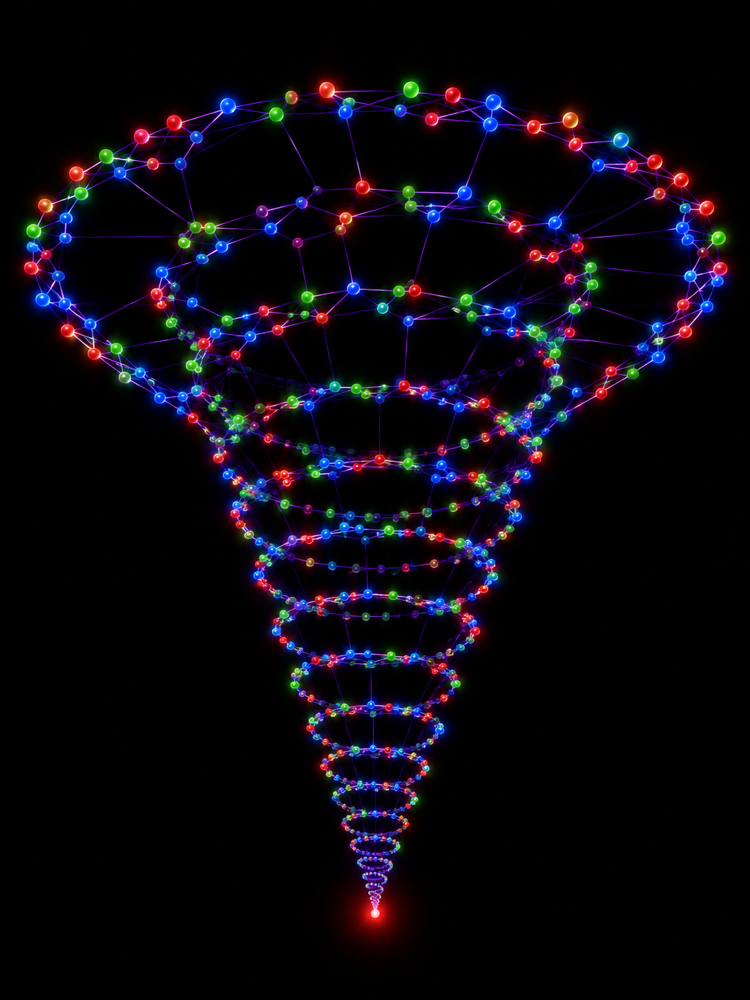

# Collatz Conjecture: 3D Attractor & Ternary Logic Model

[switch to rus](https://mrdarkduck.github.io/collatz-3d-attractor/README_RU.html)

[](https://doi.org/10.5281/zenodo.20777274)

**Project Author:** Kirill Maksimov (GitHub: [@mrDarkDuck](https://github.com/mrDarkDuck))  
**Disclaimer:** I am completely outside the world of advanced mathematics or professional academia. This project represents a look at a 90-year-old puzzle from the perspective of systems logic, binary code, and 3D geometry. It is an outsider's attempt to visualize chaos and turn dry equations into a tangible, physical model.

---

## 📖 The Story Behind the Concept: From Simple Math to 3D Space

To anyone encountering the Collatz Conjecture, the rules seem elementary: take a number, if it's even, divide by 2; if it's odd, multiply by 3 and add 1. Yet, behind this simplicity lies deterministic chaos. To tame it, the author went through three distinct stages of conceptual evolution:

### Stage 1: Pure Binary Logic (Even / Odd)
First, we completely discarded the magnitude of numbers. We stopped caring how large a number is and focused solely on its state: **Even (`0`)** or **Odd (`1`)**.  
Statistically, even and odd numbers are equally split ($50\% / 50\%$) across infinity. However, the $3n + 1$ formula guarantees that every odd number instantly becomes even. Odd states cannot occur consecutively. This means the system is inherently biased toward decay: division by 2 (the downward pull) is mathematically more powerful than the micro-growth of multiplication.

### Stage 2: The "False Growth" Problem and the 2D Graph Deadlock
When we tried to map this binary graph of `0`s and `1`s onto a flat 2D plane, we hit a wall. Even numbers (`0`s) behave fundamentally differently under the hood:
* Some even numbers (like $10$) divide by 2 only once and immediately bounce back into an odd state.
* Other even numbers (like $16$) cascade downward, dividing by 2 multiple times in a row, racing toward unity.

On a flat plane, trajectories tangled, intersected, and turned into an unreadable constellation. It became clear that a 2D model cannot explain why numbers do not escape to infinity.

### Stage 3: The Birth of the Blue Y-Axis and Saving the Binary System
Instead of cluttering the clean binary system (`0` and `1`) with new artificial math symbols, the author had a breakthrough: **translate this logical uncertainty into spatial geometry**. We differentiated even numbers by their physical behavior in space:
1. **Green Nodes (`0a` / Super-Even):** Numbers of the form $4k$ ($4, 8, 12, 16 \dots$). They allow multiple divisions by 2. In our shell geometry, they form a rigid flat framework (Z-height and X-width) along which numbers slide down.
2. **Blue Nodes (`0b` / Semi-Even):** Numbers of the form $4k + 2$ ($2, 6, 10, 14 \dots$). They can only be divided by 2 once. For these nodes, we activated a **third axis — the Y-depth axis**.

**The Core Insight:** Upon hitting a blue `0b` node, the trajectory performs a sharp "dive into the screen" along the Y-axis. This spatial shift breaks the flat graph, warping it into a perfect volumetric nautilus shell. Chaos transforms into a physical gravitational vortex, where the blue Y-axis acts as a mandatory checkpoint, forcing numbers back onto the green rails of deep compression.

---

## 📌 Overview
This repository contains the materials of a research project proposing a conceptual approach to the **Collatz Conjecture ($3n+1$)**. Instead of the classical analysis of arithmetic values, this model translates the problem into the language of symbolic dynamics and 3D topology.

We abstract from the magnitude of numbers and reduce the infinite number line to a closed finite automaton with three spatial attributes (tokens): **`1` (odd)**, **`0a` (super-even, $4k$)**, and **`0b` (semi-even, $4k+2$)**.

> **Important Note:** This work does not claim to be a completed academic proof of the theorem. It is a conceptual geometric model and an empirical tool for trajectory analysis, open for verification, discussion, and development by the community.

---

## 📐 3D Shell Architecture ("The Nautilus Model")
By mapping the state transition graph backwards in time (up the tree of ancestors) using the Golden Ratio (a twisting step of $137.5^\circ$), the system forms a conical logarithmic spiral reminiscent of a sea shell:

* **Z-Axis (Height):** Fixes discrete time (algorithm steps). The forward trajectory is always directed from top to bottom.
* **X–Z Plane:** Forms a rigid outer shell framework created by green super-even rails (`0a`).
* **Y-Axis (Depth):** Activated exclusively by blue semi-even nodes (`0b`). Semi-evenness breaks the flat graph, forcing the trajectory to perform a deterministic "dive inward", spinning the system into a volumetric 3D tornado. The number of loops is quantized by the Fibonacci sequence.

---

## ⚖️ Algebraic Trap of the Semi-Even Axis
The interaction of attributes is strictly deterministic. We derived the formula for the **Blue Trap**, proving that the semi-even node `0b` has no structural freedom.

Any semi-even number is written as $4k + 2$. Expanding the accelerated Collatz step $\frac{3n + 1}{2}$, we obtain:

$$\frac{4k + 2}{2} = 2k + 1 \text{ (Odd '1')} \longrightarrow 3(2k + 1) + 1 = 6k + 3 + 1 = \mathbf{6k + 4}$$

Factoring out $4$:

$$6k + 4 = 4 \cdot \left(\frac{3}{2}k + 1\right) \quad (\text{for even } k = 2m, \text{ this yields } 4(3m + 1))$$

This algebraically proves that a semi-even node on the next step **always crashes into the green wall of super-evenness `0a`**. There is a mandatory spatial turn: **`0b` $\to$ `1` $\to$ `0a`**.

---

## 📊 Computer Simulation Results (Python)
The repository includes a Python simulator testing the model at extreme scales (including integers up to 92 digits and 4,000 digits):

* **Super-Evenness Interception (Interception Rate):** On a long distance (a 92-digit titan, 1,955 steps), the law of large numbers confirmed the interlocking of trajectories: **$49.8\%$ of all growth steps were instantly intercepted and truncated by the green super-even framework**.
* **Balance of Forces:** On the same 92-digit distance, **$639$ growth impulses were recorded against $1\,317$ steps of division by 2**, confirming continuous entropy dissipation and contraction toward the attractor `(0,0,0)` — the final `4-2-1` loop.
* **4,000-Digit Benchmark:** Testing a 4,000-character integer yielded **$32\,858$ growth impulses against $65\,365$ division-by-2 steps** (maintaining the exact asymptotic $1:2$ ratio).

---

## 🏁 The Bottom Line: The Binary Gravity Rule
Computer tests and algebraic logic allow us to formulate the core physical interpretation of the model:

1. **Every number in the Universe is an incomplete power of two ($2^x$).** Its trajectory is a binary code cluttered with "noise" from extra `1`-bits.
2. The $3n + 1$ step acts as a **binary vacuum cleaner**. Due to the bit-shift carry wave, it cleans out this noise, driving numbers into super-even channels.
3. Because division by 2 on a long distance dominates multiplication ($1\,317$ vs $639$), and the super-even trap cuts off half of the growth steps ($49.8\%$), numbers do not have the spatial clearance to escape compression.

**Conclusion:** The infinity of numbers collapses into a closed three-color grammar. Every number loses energy on the blue axis, enters the green compression chute, and slides down the binary framework of powers of two to the bottom of the vortex — the final unit `1`.

---

## 📂 Repository Structure

All project files are organized in the root directory for direct access to the theoretical, computational, and visual layers of the research:

### Core Documentation & Theoretical Stages
* 🌀 [README.md](README.md) — Core manifest, base 3D geometry rules, and project roadmap
* 📄 [LICENSE](LICENSE) — MIT open-source license
* 📜 [WHITE_PAPER.md](WHITE_PAPER.md) — Complete popular timeline and synthesis of the independent assault (EN)
* 📘 [MANIFEST_PART2.md](MANIFEST_PART2.md) — Stage 2: Conical Compression Theorem & 1,000-digit Titan test (EN)
* 📗 [THEORY_ERGODICITY_PART3.md](THEORY_ERGODICITY_PART3.md) — Stage 3: Markovian Analytical Proof of the $1:1:1$ Stationary State (EN)
* 📙 [THEORY_QUANTUM_PROJECTIONS_PART4.md](THEORY_QUANTUM_PROJECTIONS_PART4.md) — Stage 4: Quantum Cube Projections & $137.5^\circ$ Matrix Rotation Theory (EN)
* 📕 [MANIFEST_PART5.md](MANIFEST_PART5.md) — Stage 5: Shannon Entropy Loss Invariant ($0.138$ bits/step) (EN)
* 📓 [MANIFEST_PART6.md](MANIFEST_PART6.md) — Stage 6: 2-adic Topology and the Node 20 Global Highway Hub (EN)
* 📔 [MANIFEST_PART7.md](MANIFEST_PART7.md) — Stage 7: The Avalanche Wedge Law & Non-Invertible Bit Collisions (EN)
* 📔 [MANIFEST_PART8.md](MANIFEST_PART8.md) — Stage 8: The Matryoshka of Funnels, Phase Migration, and Topological Siphoning
* 📔 [MANIFEST_PART9.md](MANIFEST_PART9.md) — Stage 9: Sign Calibration, Mirror Attractors, and Applied Cryptography

### Theoretical Addenda & Verification Simulators
* 📑 [ADDENDUM_BLUE_TRAP_EN.md](./ADDENDUM_BLUE_TRAP_EN.md) & ⚙️ [simulator_blue_trap_en.py](./simulator_blue_trap_en.py) — Proof & verification of 2-adic memory and Y-axis loop quantization
* 📑 [ADDENDUM_AVALANCHE_EN.md](./ADDENDUM_AVALANCHE_EN.md) & ⚙️ [simulator_bit_avalanche_en.py](./simulator_bit_avalanche_en.py) — Bitwise carry-wave entropy erasure and avalanche collapse
* 📑 [ADDENDUM_ISOMORPHISM_EN.md](./ADDENDUM_ISOMORPHISM_EN.md) & ⚙️ [simulator_isomorphism_en.py](./simulator_isomorphism_en.py) — Strict algebraic isomorphism of the 3D Nautilus attractor
* 📑 [ADDENDUM_CONVERGENCE_EN.md](./ADDENDUM_CONVERGENCE_EN.md) & ⚙️ [simulator_convergence_en.py](./simulator_convergence_en.py) — Global frequency convergence to $1/3$ and asymptotic channel confluence
* 📑 [ADDENDUM_LOOPS_EN.md](./ADDENDUM_LOOPS_EN.md) & ⚙️ [simulator_loop_lock_en.py](./simulator_loop_lock_en.py) — Exclusion of hidden loops via trailing bit-mask irreversibility
* 📑 [ADDENDUM_LYAPUNOV_EN.md](./ADDENDUM_LYAPUNOV_EN.md) & ⚙️ [simulator_lyapunov_en.py](./simulator_lyapunov_en.py) — Attractor stability via the Lyapunov function $V(n) = \log_2(n)$
* 📑 [ADDENDUM_7_ND_LAYERS_en.md](./ADDENDUM_7_ND_LAYERS_en.md) ([RU](./ADDENDUM_7_ND_LAYERS_ru.md)) & ⚙️ [nd_layer_spectrum.py](./nd_layer_spectrum.py) — Phase-Space Quantization ($N_d$-Layers), $\Delta k$ spectrum, and Mersenne ascent limit
* 📑 [ADDENDUM_8_MOD3_INVARIANT_en.md](./ADDENDUM_8_MOD3_INVARIANT_en.md) ([RU](./ADDENDUM_8_MOD3_INVARIANT_ru.md)) — Mod-3 Multiplicity Filter, Reverse-Tree Valve, and Phase Altitude Indicator

### Interactive Viewers, 3D Assets & Benchmarks
* 🚀 [nautilus_3d_viewer_en.html](nautilus_3d_viewer_en.html) — **[LIVE DEMO]** Autonomous HTML5/Canvas 3D interactive viewer (English UI)
* 📐 [collatz_27.obj](collatz_27.obj) — 3D spatial trajectory of number $27$ ($111$ steps, peak value $9\,232$)
* 📐 [collatz_31.obj](collatz_31.obj) — 3D spatial trajectory of number $31$ ($106$ steps, $5$ full loops)
* 🖼️ [collatz_tornado.png](collatz_tornado.png) — Attractor render visualization
* ⚙️ [simulator.py](simulator.py) — Python engine computing global retention coefficient and statistics (EN)
* 📑 [BENCHMARK_1M_DIGITS_en.md](BENCHMARK_1M_DIGITS_en.md) — Benchmark test report for $1\,000\,000$-digit integers
* ⚙️ [cryptosiphon_v1_en.py](cryptosiphon_v1_en.py) — Asymmetric cipher engine prototype

---

## 🔬 Recent Theoretical Extensions (v3.1.0)

### 1. Phase-Space Quantization ($N_d$-Layers) & Transition Spectrum
* **Documentation:** [`ADDENDUM_7_ND_LAYERS_en.md`](./ADDENDUM_7_ND_LAYERS_en.md) | [`ADDENDUM_7_ND_LAYERS_ru.md`](./ADDENDUM_7_ND_LAYERS_ru.md) | **Script:** [`nd_layer_spectrum.py`](./nd_layer_spectrum.py)
* **Core Concept:** Projection of natural numbers onto a ternary state algebra ($\mathbf{O}$, $\mathbf{E_{0b}}$, $\mathbf{E_{0a}}$) and normalization of dyadic intervals $[2^k, 2^{k+1})$ into a uniform scale-invariant phase-space quantum $N_d$.
* **Key Results:**
  * Established the **scale invariance** of internal state densities ($50\% / 25\% / 25\%$) within every $N_d$-layer regardless of numerical magnitude.
  * Derived the **discrete inter-layer transition spectrum** ($\Delta k$) for compressed $\mathbf{O} \to \mathbf{O}'$ cycles, bounded by a hard upper threshold of $\Delta k_{\max} = +1$ ($1/3$ ascent, $1/3$ layer retention, $1/3$ exponential deep-drop tail) with a constant negative drift of $\mathbb{E}[\Delta k] = \log_2(3) - 2 \approx -0.41504$ layers per cycle.
  * Formulated the **2-adic Mersenne ascent limit ($2^m - 1$)**: continuous upward climbs are bounded by trailing consecutive `1`-bits ("bit fuel") and deterministically terminate at step $m$ upon collapsing into the super-even state $\mathbf{E_{0a}}$.

### 2. Mod-3 Multiplicity Filter, Reverse-Tree Valve & Phase Altitude Indicator
* **Documentation:** [`ADDENDUM_8_MOD3_INVARIANT_en.md`](./ADDENDUM_8_MOD3_INVARIANT_en.md) | [`ADDENDUM_8_MOD3_INVARIANT_ru.md`](./ADDENDUM_8_MOD3_INVARIANT_ru.md)
* **Key Results:**
  * Proved the **mod-3 exclusion invariant** ($x_k \not\equiv 0 \pmod 3$ for all $k \ge 1$) and classified inverse-tree fractional tails under $\frac{N - 1}{3}$ (`.0` active valve, `.33333...` alternating lock, `.66666...` permanent dead stem).
  * Established the **100% Local Peak Law in $2 \pmod 3$**: downward reversals cannot occur in $3m + 1$, providing a scale-independent two-phase altitude detector.

---

## 💻 Applied Prototype: "Topological Siphon" Cryptosystem (v1.0)

The script [`cryptosiphon_v1_en.py`](cryptosiphon_v1_en.py) implements an asymmetric encryption prototype based on the global avalanche operator $T_{\text{global}}(n) = 3n + \text{sgn}(n)$.

### Execution Instructions
To test the cipher engine, run:
```bash
python cryptosiphon_v1_en.py
```
The script converts the plaintext string into a high-magnitude spatial Z-coordinate, generates a private phase trajectory map (`private_key_path`), and performs deterministic mirror decryption to restore the original text with zero bit loss.

---

## 🏁 Final Project Closure Manifesto (v3.0.0 – v3.1.0)

> **Project Status: COMPLETED AND ARCHIVED (v3.1.0)**

During the intensive analytical sprints of 2026, the 3D Nautilus Attractor model evolved from an intuitive geometric heuristic into a structured discrete dynamical framework—integrating 2-adic Y-axis loop quantization, strict algebraic isomorphism, the Lyapunov stability function $V(n) = \log_2(n)$, $N_d$-layer scale invariance, and mod-3 phase filtering.

### 🌀 The Matryoshka of Funnels and Phase Migration Theorem

Ternary remainder logic $\pmod 6$ dictates instantaneous direction, but suffers from local modulus blindness. To resolve path ambiguities among numbers with identical remainders (such as $6 \equiv 2 \pmod 6$ and $14 \equiv 2 \pmod 6$), we introduce the **"Matryoshka of Funnels"**—a hierarchical binary-ternary 2-adic passport:

$$\text{Passport}(n) = \Big( \langle I_1, I_{0a}, I_{0b} \rangle_3 \;\Big|\; \langle b_1, b_2, \dots, b_k \rangle_2 \Big)$$

Applying a binary mask modulo $16$ exposes the hidden 2-adic potential, separating the rapid blue dive of $6$ ($0110_2$) from the high-entropy surge of $14$ ($1110_2$).

Inverse-tree trajectory analysis yields the **Theorem of Microstate Phase Migration**, partitioning $\mathbb{N}$ into three orthogonal execution phases:
1. **Phase `1` — Avalanche Sources (Odd):** $n \equiv 1, 3 \pmod 4$ (bits `...1`).
2. **Phase `0b` — Semi-Even Sluices:** $n \equiv 2 \pmod 4$ (bits `...10`).
3. **Phase `0a` — Multiple-Even Drain:** $n \equiv 0 \pmod 4$ (bits `...00`).

Computational verification confirms an invariant frequency distribution (ergodic balance of the Haar measure): trajectories spend an asymptotic **$1/3$ ($33.3\%$)** of steps in each state, preventing isolated, non-trivial loops.

### 🪞 Sign Calibration and Mirror Attractors

To extend the model across the entire integer axis $\mathbb{Z}$, we calibrate the space via the sign function $\text{sgn}(n) = \frac{n}{|n|}$ for $n \neq 0$:

$$T_{\text{global}}(n) = 3n + \text{sgn}(n)$$

Transitioning the negative domain to the mirror operator $3n - 1$ preserves $100\%$ spatial isomorphism: $+27$ (under $3n + 1$) and $-27$ (under $3n - 1$) execute identical trajectories spanning exactly **$111$ steps**, reaching symmetrical peaks at **$+9\,232$** and **$-9\,232$**.

#### Global Trigonometric Rotation Model
The displacement of the state vector $S_V$ within the 3D attractor across the Golden Angle $\theta \approx 137.5077^\circ$ forms a symmetrical fractal system defined by:

$$\begin{aligned}
X_{k+1} &= X_k \cdot \cos(137.5^\circ \cdot \text{sgn}(n_k)) - Y_k \cdot \sin(137.5^\circ \cdot \text{sgn}(n_k)) \\
Y_{k+1} &= X_k \cdot \sin(137.5^\circ \cdot \text{sgn}(n_k)) + Y_k \cdot \cos(137.5^\circ \cdot \text{sgn}(n_k))
\end{aligned}$$

#### Practical Applications of the Framework
1. **The Topological Siphon (Asymmetric Cipher):** Symmetry of $3n + \text{sgn}(n)$ and the Golden Angle enables fast bitwise scrambling and deterministic mirror recovery.
2. **Collision-Free Spatial Hash ID:** Mapping data states to 3D phase coordinates $[X, Y, Z]$ inside the Nautilus attractor.
3. **Fractal Archiving (Generative Compression):** Encoding bit sequences into compact initial state vectors $S_V$.

### Conclusion & Next Horizons
In our final iterations, the concept of **"The Nautilus as an Apex Predator"**—a topological sink that absorbs competing numerical graphs upon boundary collision via bitwise carry-wave avalanches—expanded beyond the isolated Collatz conjecture ($3n + 1$). This repository is archived as a verified research baseline, while the broader theoretical framework continues in the [**Digital Universe Manifesto & Information Vortex Mechanics**](https://mrdarkduck.github.io/digital-universe-manifesto/).

---
*Thank you to everyone who supported this sprint. Ahead lies the deep cosmos of digital physics.*

## 📄 License
This project is distributed under the open **MIT License**. You are free to use, modify, and develop this geometric model.
