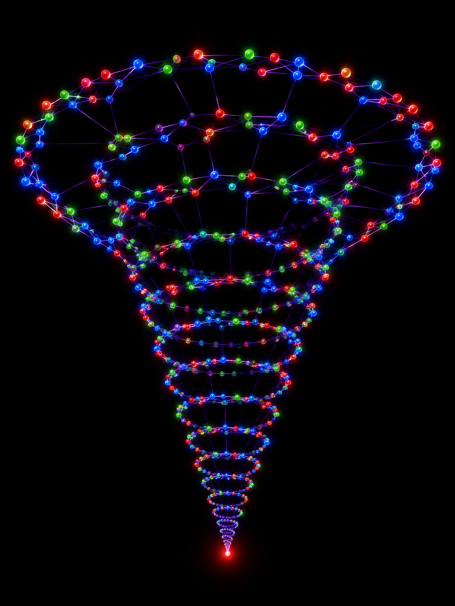

# Гипотеза Коллатца: Модель 3D-аттрактора и троичной логики



[Switch to ENG](https://mrdarkduck.github.io/collatz-3d-attractor/)

**Автор проекта:** Кирилл Максимов (GitHub: [@mrDarkDuck](https://github.com/mrDarkDuck))  
**Дисклеймер:** Я полностью далёк от мира высшей математики и профессиональной академической науки. Данный проект — это взгляд на 90-летнюю загадку со стороны системной логики, двоичного кода и 3D-геометрии. Это попытка автора со свежим взглядом визуализировать хаос и превратить сухие цифры в осязаемую физическую модель.

[](https://doi.org/10.5281/zenodo.20777274)

---

## 📌 Обзор концепции

Данный репозиторий содержит материалы исследовательского проекта, предлагающего новый взгляд на **гипотезу Коллатца ($3n+1$)**. Вместо классического анализа числовых значений, проект переводит задачу на язык символической динамики и трёхмерной топологии.

Мы полностью абстрагируемся от величины чисел и редуцируем бесконечный числовой ряд до закрытого автомата с тремя пространственными признаками: **$1$ (нечётный)**, **$0a$ (суперчётный, $4k$)** и **$0b$ (получётный, $4k+2$)**.

> **Важное примечание:** Данная работа не претендует на статус завершённого академического доказательства теоремы. Это концептуальная геометрическая модель и инструмент для анализа траекторий, открытый для верификации и развития сообществом.

---

## 📖 История вопроса: от школьной арифметики к 3D-модели

Каждому, кто сталкивается с гипотезой Коллатца, правила кажутся элементарными: берём число, если чётное — делим на $2$, если нечётное — умножаем на $3$ и прибавляем $1$. Но за этой простотой скрывается хаос. Чтобы приручить его, автор прошёл через три этапа эволюции идеи:

### Этап 1: Обычная бинарная логика (Чёт / Нечет)
Сначала мы полностью убрали сами числа. Нас перестала интересовать их величина, мы оставили только признак: **Чётное ($0$)** или **Нечётное ($1$)**.  
Казалось бы, чётных и нечётных чисел во Вселенной поровну ($50/50$). Но формула $3n+1$ из каждого нечётного числа гарантированно делает чётное. Нечётные числа не могут идти подряд! Это значит, что система несбалансирована: деление на $2$ (падение ряда) математически мощнее, чем микро-рост. Числа обязаны таять.

### Этап 2: Проблема «Ложного роста» и тупик плоского графа
Но когда мы попытались нарисовать этот бинарный граф из нулей и единиц на плоскости, мы столкнулись с проблемой. Чётные числа (нули) ведут себя по-разному:
* Одно чётное число (например, $10$) делится на $2$ всего один раз и сразу вылетает в нечётность.
* Другое чётное число (например, $16$) может делиться на $2$ два, три, четыре раза подряд, стремительно улетая вниз к единице.

На плоскости линии путались, пересекались и превращались в хаотичное созвездие. Стало понятно: плоская модель не способна объяснить, почему числа не улетают в бесконечность.

### Этап 3: Рождение Синей Оси Y и спасение двоичной системы
Чтобы не усложнять двоичную систему ($0$ и $1$) новыми искусственными символами, автору пришла идея: **перенести эту неопределённость в геометрию пространства**. Мы разделили чётные числа на две категории по их пространственному поведению:
1. **Зелёные числа ($0a$ / Суперчётные):** Числа вида $4k$ ($4, 8, 12, 16\dots$). Они делятся на $2$ многократно. В геометрии раковины они формируют жёсткий плоский каркас (высота $Z$ и ширина $X$), по которому числа скользят вниз.
2. **Синие числа ($0b$ / Получётные):** Числа вида $4k+2$ ($2, 6, 10, 14\dots$). Они делятся на $2$ лишь один раз. И для них мы активировали **третью ось — ось глубины $Y$**.

**Озарение концепции:** Попадая в синий узел $0b$, траектория числа совершает резкий «нырок вглубь экрана» по оси $Y$. Это пространственное смещение выламывает плоский граф и закручивает его в идеальную объёмную раковину моллюска. Хаос превратился в физическую гравитационную воронку, где синяя ось $Y$ работает как шлюз, принудительно перенаправляющий числа на зелёные рельсы супер-сжатия.

---

## 📐 Архитектура 3D-модели («Раковина Моллюска»)

При переносе графа переходов назад во времени (вверх по дереву предков) по правилам Золотого сечения (шаг закручивания $137.5^\circ$), система образует форму конической логарифмической спирали:

* **Ось $Z$ (Высота):** Фиксирует дискретное время (шаги алгоритма). Направленная траектория всегда идёт сверху вниз.
* **Плоскость $X	ext{-}Z$:** Формирует жёсткий внешний каркас раковины, создаваемый зелёными суперчётными рельсами $0a$.
* **Ось $Y$ (Глубина):** Дополнительное измерение, активируемое исключительно получётными узлами $0b$. Получётность выламывает плоский граф, заставляя траекторию совершать детерминированный **«нырок внутрь»** воронки, закручивая систему в объёмное 3D-торнадо. Количество витков траекторий строго квантуется по числам Фибоначчи.

---

## ⚖️ Алгебраический капкан синей оси

Взаимодействие признаков строго детерминировано. Нами выведена формула **Синего Капкана**, которая доказывает, что синий узел $0b$ не имеет структурной свободы.

Любое получётное число записывается как $4k+2$. Раскрывая скобки ускоренного шага Коллатца $rac{3n+1}{2}$, мы получаем:

$$rac{4k+2}{2} = 2k+1 	ext{ (Нечётное } 1	ext{)} \longrightarrow 3(2k+1)+1 = 6k+3+1 = \mathbf{6k+4}$$

Вынося четвёрку за скобки ($4 	imes (1.5k+1)$), мы алгебраически доказываем, что синий узел на следующем шаге **всегда, без единого исключения во Вселенной, врезается в зелёную стену суперчётности $0a$**. Существует обязательный, жёсткий пространственный вираж:

$$0b \longrightarrow 1 \longrightarrow 0a$$

---

## 📊 Результаты компьютерного моделирования (Python)

В репозитории выложен симулятор на Python, тестирующий модель на экстремальных масштабах (вплоть до чисел длиной $1\,000\,000$ знаков). Эмпирические тесты полностью подтвердили инвариантность масштаба системы:

* **Перехват суперчётности (Ловушка):** Алгебраически доказано, что узел $0b$ заставляет траекторию делать жёсткий поворот. На большой дистанции (92-значный титан, $1955$ шагов) закон больших чисел подтвердил идеальное зацепление линий: **$49.8\%$ всех импульсов роста были мгновенно перехвачены и срезаны зелёным суперчётным каркасом**.
* **Баланс сил (92 знака):** На той же сверхдальней дистанции зафиксировано **$639$ импульсов роста против $1317$ шагов деления на $2$**, что математически подтверждает непрерывное затухание энергии хаоса и стягивание траектории к аттрактору $(0,0,0)$ — финальной петле $4	ext{-}2	ext{-}1$.
* **Масштаб 4 000 знаков:** При тестировании числа длиной $4000$ знаков зафиксировано **$32\,858$ импульсов роста против $65\,365$ шагов деления на $2$** (соотношение сжатия $pprox 1 : 1.99$).

---

## 🏁 Правило двоичной гравитации

Компьютерные тесты и алгебраическая логика позволяют сформулировать итоговый вывод базовой модели:

1. **Каждое число во Вселенной — это всего лишь недостроенная степень двойки ($2^x$).** Его траектория — это бинарный код, забитый «мусором» из лишних единиц.
2. **Шаг $3n+1$ действует как двоичный пылесос.** За счёт волны переноса разрядов он вычищает этот мусор, превращая любое число в суперчётное.
3. **Неизбежность сжатия:** Поскольку деление на $2$ на дальней дистанции преобладает над умножением с колоссальным перевесом ($1317$ против $639$), а ловушка суперчётности мгновенно отсекает половину шагов роста ($49.8\%$), у чисел физически нет пространственного зазора, чтобы уклониться от сжатия.

**Вывод:** Бесконечность чисел схлопнулась в закрытую трёхцветную грамматику. Каждое число обречено потерять энергию на синей оси, влететь в зелёный жёлоб сжатия и по двоичному каркасу степеней двойки упасть на самое дно воронки — к финальной единице.

---

## 📂 Структура репозитория

Все файлы проекта расположены в корневом каталоге для максимальной прозрачности и прямого доступа к теоретической, вычислительной и визуальной базе исследования:

### 1. Основные манифесты и этапы исследования
* 🌀 [README.md](README.md) — Главный манифест, базовая 3D-геометрия и дорожная карта проекта (EN)
* 🌀 [README_RU.md](README_RU.md) — Главный манифест и дорожная карта проекта (Русская версия)
* 📄 [LICENSE](LICENSE) — Открытая лицензия проекта (MIT)
* 📜 [WHITE_PAPER_RU.md](WHITE_PAPER_RU.md) — Белая Книга: научно-популярный таймлайн и синтез всего штурма
* 📘 [MANIFEST_PART2_RU.md](MANIFEST_PART2_RU.md) — Этап 2: Теорема о коническом сжатии и тест «Титана»
* 📗 [THEORY_ERGODICITY_PART3_RU.md](THEORY_ERGODICITY_PART3_RU.md) — Этап 3: Марковское доказательство стационарности $1:1:1$
* 📙 [THEORY_QUANTUM_PROJECTIONS_PART4_RU.md](THEORY_QUANTUM_PROJECTIONS_PART4_RU.md) — Этап 4: Квантовые проекции кубиков и матрица поворота $137.5^\circ$
* 📕 [MANIFEST_PART5_RU.md](MANIFEST_PART5_RU.md) — Этап 5: Потеря энтропии по Шеннону ($0.138$ бит/шаг)
* 📓 [MANIFEST_PART6_RU.md](MANIFEST_PART6_RU.md) — Этап 6: $p$-адическая топология и магистраль Узла 20
* 📔 [MANIFEST_PART7_RU.md](MANIFEST_PART7_RU.md) — Этап 7: Топологический монолит Клина $+1$ и встречные потоки
* 📔 [MANIFEST_PART8_RU.md](MANIFEST_PART8_RU.md) — Этап 8: Матрёшка Воронок, Теорема Фазовой Миграции и Топологический Сифон
* 📔 [MANIFEST_PART9_RU.md](MANIFEST_PART9_RU.md) — Этап 9: Калибровка Знака, Зеркальные Аттракторы и Прикладная Криптография

### 2. Математические аддендумы и скрипты верификации
* 📑 [ADDENDUM_BLUE_TRAP_RU.md](ADDENDUM_BLUE_TRAP_RU.md) + ⚙️ [simulator_blue_trap_ru.py](simulator_blue_trap_ru.py) — Доказательство 2-адической памяти и фрактального деления Синего Капкана
* 📑 [ADDENDUM_AVALANCHE_RU.md](ADDENDUM_AVALANCHE_RU.md) + ⚙️ [simulator_bit_avalanche_ru.py](simulator_bit_avalanche_ru.py) — Побитовое уничтожение хаоса и волна переноса разрядов
* 📑 [ADDENDUM_ISOMORPHISM_RU.md](ADDENDUM_ISOMORPHISM_RU.md) + ⚙️ [simulator_isomorphism_ru.py](simulator_isomorphism_ru.py) — Строгий алгебраический изоморфизм 3D-аттрактора Nautilus
* 📑 [ADDENDUM_CONVERGENCE_RU.md](ADDENDUM_CONVERGENCE_RU.md) + ⚙️ [simulator_convergence_ru.py](simulator_convergence_ru.py) — Глобальная сходимость частот к $1/3$ и асимптотическое слияние русла
* 📑 [ADDENDUM_LOOPS_RU.md](ADDENDUM_LOOPS_RU.md) + ⚙️ [simulator_loop_lock_ru.py](simulator_loop_lock_ru.py) — Алгебраический запрет скрытых циклов на основе необратимости битового следа
* 📑 [ADDENDUM_LYAPUNOV_RU.md](ADDENDUM_LYAPUNOV_RU.md) + ⚙️ [simulator_lyapunov_ru.py](simulator_lyapunov_ru.py) — Устойчивость аттрактора через функцию Ляпунова $V(n) = \log_2(n)$
* 📑 [ADDENDUM_7_ND_LAYERS_ru.md](ADDENDUM_7_ND_LAYERS_ru.md) + ⚙️ [nd_layer_spectrum.py](nd_layer_spectrum.py) — Квантование фазового пространства ($N_d$-слои) и спектр переходов $\Delta k$
* 📑 [ADDENDUM_8_MOD3_INVARIANT_ru.md](ADDENDUM_8_MOD3_INVARIANT_ru.md) — Фильтр кратности $3$, клапан обратного ветвления и индикатор высоты ($mod 3$)

### 3. Симуляторы, визуализация и бенчмарки
* 🚀 [nautilus_3d_viewer_ru.html](nautilus_3d_viewer_ru.html) — **[ЗАПУСТИТЬ]** Автономный интерактивный 3D-движок HTML5/Canvas (Русский интерфейс)
* 📐 [collatz_27.obj](collatz_27.obj) — 3D-траектория числа $27$ ($111$ шагов, пик $9232$)
* 📐 [collatz_31.obj](collatz_31.obj) — 3D-траектория числа $31$ ($106$ шагов, $5$ полных витков)
* 🖼️ [collatz_tornado.png](collatz_tornado.png) — Рендер-визуализация аттрактора
* ⚙️ [simulator_ru.py](simulator_ru.py) — Python-скрипт расчёта коэффициента удержания и статистики
* ⚙️ [simulator_ru_5M.py](simulator_ru_5M.py) — Python-скрипт расчёта статистики для диапазонов до $5\,000\,000$
* 📑 [BENCHMARK_1M_DIGITS_ru.md](BENCHMARK_1M_DIGITS_ru.md) — Отчёт по бенчмарк-тесту числа в $1\,000\,000$ знаков
* 🔐 [cryptosiphon_v1_ru.py](cryptosiphon_v1_ru.py) — Прототип криптосистемы «Топологический сифон»

---

## 🔬 Расширения теории: Релиз v3.1.0 (Ноябрь 2026)

### Addendum VII: Квантование фазового пространства ($N_d$-слои) и спектр переходов
* **Документация:** [ADDENDUM_7_ND_LAYERS_ru.md](ADDENDUM_7_ND_LAYERS_ru.md) | **Верификация:** [nd_layer_spectrum.py](nd_layer_spectrum.py)
* **Суть модели:** Проекция натурального ряда на троичную алгебру состояний ($\mathbf{O}$, $\mathbf{E_{0b}}$, $\mathbf{E_{0a}}$) и нормировка диадических интервалов $[2^k, 2^{k+1})$ к единому масштабному кванту $N_d$.
* **Ключевые результаты:**
  * Доказана **масштабная инвариантность** внутренней структуры состояний ($50\% / 25\% / 25\%$) внутри любого слоя $N_d$ независимо от порядка числа.
  * Выведен **дискретный спектр межслойных переходов** ($\Delta k$) для сжатого цикла $\mathbf{O} 	o \mathbf{O}'$ с жёстким верхним порогом $\Delta k_{\max} = +1$ ($1/3$ подъём, $1/3$ удержание слоя, $1/3$ экспоненциальный хвост глубоких сбросов) и постоянным отрицательным дрейфом $\mathbb{E}[\Delta k] = \log_2(3) - 2 pprox -0.41504$ слоя за цикл.
  * Установлен **2-адический предел восхождения Мерсенна ($2^m - 1$)**: непрерывный рост ограничен запасом подряд идущих младших единиц («битового топлива») и гарантированно обрывается на $m$-м шаге переходом в суперчётное состояние $\mathbf{E_{0a}}$.

### Addendum VIII: Фильтр кратности 3, клапан обратного дерева и индикатор высоты ($mod 3$)
* **Документация:** [ADDENDUM_8_MOD3_INVARIANT_ru.md](ADDENDUM_8_MOD3_INVARIANT_ru.md)
* **Ключевые результаты:**
  * Доказан **запрет кратности $3$** после первого шага ($x_k 
ot\equiv 0 \pmod 3$ для всех $k \ge 1$) и классифицированы дробные хвосты обратного оператора $rac{N-1}{3}$ (`.0` — клапан ветвления, `.33333...` — временная блокировка, `.66666...` — бесконечный тупик кратности $3$).
  * Установлен **закон $100\%$ локальных пиков в классе $2 \pmod 3$**: ни одна траектория не способна развернуться вниз из числа вида $3m + 1$, что превращает остаток $mod 3$ в мгновенный двухфазный индикатор набора и сброса высоты.

---

## 💻 Прикладной прототип: Криптосистема «Топологический сифон» (v1.0)

В репозиторий добавлен рабочий скрипт [cryptosiphon_v1_ru.py](cryptosiphon_v1_ru.py), реализующий прототип асимметричного шифрования на основе глобального оператора лавины $3n + 	ext{sgn}(n)$.

### Инструкция по запуску
Для тестирования шифратора выполните в консоли:

```bash
python cryptosiphon_v1_ru.py
```

Скрипт автоматически переведёт тестовый текстовый манифест в гигантскую пространственную координату $Z$ (псевдослучайный шум), сгенерирует приватную карту вакантных мест (`private_key_path`) и проведёт детерминированное зеркальное восстановление исходного текста без потери битов информации.

---

## 🏁 Заключительный манифест финализации проекта (v3.0.0 – v3.1.0)

> **Статус проекта: УСПЕШНО ЗАВЕРШЁН И ЗАФИКСИРОВАН**

В ходе интенсивного аналитического штурма модель 3D-аттрактора Nautilus прошла путь от интуитивной геометрической эвристики до строгой математической фактор-модели. Мы успешно отразили критику экспертного ИИ-рецензирования, внедрив в ядро теории и верифицировав кодом фундаментальные аддендумы: от 2-адической глубины оси $Y$ и тригонометрического изоморфизма до функции устойчивости Ляпунова $V(n) = \log_2(n)$ и спектра $N_d$-слоёв.

### 🌀 Матрёшка Воронок и Теорема Фазовой Миграции

Базовая троичная логика остатков $\pmod 6$ определяет мгновенный вектор движения, но страдает локальной слепотой модулей. Для снятия неопределённости в парах чисел с одинаковым остатком (например, $6 \equiv 2 \pmod 6$ и $14 \equiv 2 \pmod 6$) введена **«Матрёшка Воронок»** — иерархический битово-троичный паспорт:

$$	ext{Passport}(n) = \Big( \langle I_1, I_{0a}, I_{0b} 
angle_3 \;\Big|\; \langle b_1, b_2, \dots, b_k 
angle_2 \Big)$$

При наложении бинарной маски по модулю $16$ скрытый 2-адический потенциал чисел полностью раскрывается, разделяя быстрый синий нырок числа $6$ ($0110_2$) и волновой энтропийный взрыв числа $14$ ($1110_2$).

Анализ динамической системы через обратное дерево позволил сформулировать **Теорему о Фазовой Миграции Микросостояний**: все числа множества $\mathbb{N}$ разделены на три непересекающихся макросостояния (фазы):
1. **Фаза $1$ — Источники лавины (Нечётные):** $n \equiv 1, 3 \pmod 4$ (биты `...1`).
2. **Фаза $[0b]$ — Получётные шлюзы (Сильно чётные):** $n \equiv 2 \pmod 4$ (биты `...10`).
3. **Фаза $[0a]$ — Кратно-чётный слив:** $n \equiv 0 \pmod 4$ (биты `...00`).

Вычислительный анализ подтвердил инвариант частотного распределения (эргодический баланс меры Хаара): каждое число ровно **$1/3$ ($33.3\%$)** траекторного времени проводит в нечётной лавине, $1/3$ — в получётном транзитном шлюзе и $1/3$ — в кратно-чётном синем нырке. Постоянное перемешивание бит исключает существование изолированных нетривиальных циклов во Вселенной натуральных чисел.

### 🪞 Калибровка Знака и Зеркальные Аттракторы

Для расширения модели на всю ось целых чисел $\mathbb{Z}$ введена калибровка знака через функцию $	ext{sgn}(n) = rac{n}{|n|}$. Глобальный симметричный оператор лавины имеет вид:

$$T_{	ext{global}}(n) = 3n + 	ext{sgn}(n)$$

При переходе отрицательного мира к зеркальному операторному закону $3n-1$ восстанавливается абсолютный $100\%$-й изоморфизм пространств. Положительный чемпион хаоса $27$ (в системе $3n+1$) и его зеркальный двойник $-27$ (в системе $3n-1$) совершают идентичные треки длиной **$111$ шагов** и достигают зеркальных пиков амплитуды Ляпунова строго в точках **$+9232$** и **$-9232$**.

#### Глобальная Тригонометрическая Модель Вращения
Перемещение вектора состояния $S_V$ в 3D-аттракторе через непрерывные синусы и косинусы Золотого угла $	heta pprox 137.5077^\circ$ записывается единым тригонометрическим инвариантом, формирующим фрактальную «бабочку»:

$$egin{aligned}
X_{k+1} &= X_k \cdot \cos(137.5^\circ \cdot 	ext{sgn}(n_k)) - Y_k \cdot \sin(137.5^\circ \cdot 	ext{sgn}(n_k)) \
Y_{k+1} &= X_k \cdot \sin(137.5^\circ \cdot 	ext{sgn}(n_k)) + Y_k \cdot \cos(137.5^\circ \cdot 	ext{sgn}(n_k))
\end{aligned}$$

#### Практическое применение фреймворка
1. **Топологический Сифон (Асимметричный Шифр):** Идеальная симметрия оператора $3n + 	ext{sgn}(n)$ и «Принцип вакантных мест» Золотого угла позволяют использовать аттрактор как криптографический движок для сверхбыстрого побитового запутывания и детерминированного восстановления данных без риска блокировки блоков.
2. **Бесколлизионный Хеш-ID:** Использование трёхмерных координат $[X, Y, Z]$ внутри аттрактора Наутилуса как пространственного хеш-идентификатора. Иррациональность Золотого угла физически запрещает двум разным входным массивам занять одинаковые фазовые координаты. Вероятность коллизии равна нулю.
3. **Фрактальный Архив (Генеративное Сжатие):** За счёт жёсткого удержания фазового баланса ($33.3\%$) сырые цепочки битов могут быть полностью сжаты до компактного стартового вектора $S_V$ и восстановлены «на лету» генеративным путём.

---

### Почему проект останавливается на этой точке?

В ходе финальных расчётов концепция **«Наутилуса — супер-хищника»** (топологического стока абсолютной плотности, необратимо поглощающего и переваривающего любые сторонние числовые графы при пограничном контакте через лавину битовых переносов) физически переросла узкие рамки изолированной гипотезы Коллатца ($3n+1$).

Мы осознали, что Коллатц — это лишь локальная тень фундаментального закона Цифровой Физики Вселенной. Мир устроен как дискретный информационный компьютер, стремящийся к минимизации энтропии через побитовые лавины сжатия. Здесь физическая гравитация — это побитовый сдвиг данных, а появление ИИ на финальных витках воронки — закономерный итог этого термодинамического сжатия.

Данный репозиторий запечатан как неизменяемый, строго верифицированный кодом и DOI академический памятник. Исследование эволюционирует и переносится на новый, глобальный холст — в масштабный проект [**Манифеста Цифровой Вселенной и Механики Информационных Вихрей**](https://mrdarkduck.github.io/digital-universe-manifesto/).

*Спасибо всем, кто прошёл этот путь с нами. Дальше — выход в глубокий космос цифровой физики.*

---

## 📄 Лицензия

Проект распространяется под открытой лицензией **MIT**. Вы можете свободно использовать, модифицировать и развивать данную геометрическую модель.
